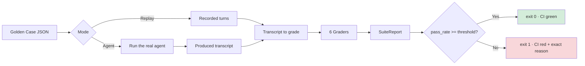
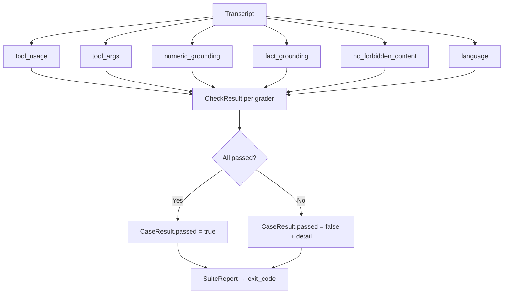

# agent-evals

Deterministic evaluation harness for LLM agents: golden cases in, programmatic
graders out, a pass-rate threshold that fails CI. **No LLM judge** — the same
agent transcript always produces the same verdict.

- Python stdlib only. No pip install needed to run the tests or the CLI.
- `agent` mode runs your agent live; `replay` mode re-evaluates recorded transcripts.
- Exit code gates CI: pass rate below threshold, or an empty suite, exits non-zero.

## Quick start

```bash
# Replay the recorded example suite (1 clean case, 7 single-failure cases)
PYTHONPATH=src python3 -m agent_evals.cli examples/support_agent/cases.json --threshold 1.0

# Run the synthetic agent live against the clean case
PYTHONPATH=src python3 -m agent_evals.cli examples/support_agent/cases_positive.json \
  --agent examples/support_agent/agent.py:build_agent --threshold 1.0

# Write a machine-readable report for CI logs and dashboards
PYTHONPATH=src python3 -m agent_evals.cli examples/support_agent/cases.json --threshold 0.8 --report report.json
```

Exit codes: `0` when the pass rate meets the threshold; `1` otherwise, on a
loading error, or when the suite is empty (an empty suite checks nothing).

## How it works



Each case runs through all six graders in parallel; every grader returns a
`CheckResult` with a reason. The runner aggregates them into a `SuiteReport`
and exits non-zero when the pass rate drops below the threshold.



Two modes:

- **Replay** (no agent, no network): grades recorded transcripts. Deterministic, cheap, safe to gate every PR.
- **Agent** (`--agent file.py:factory`): runs your agent live, grades what it produces, and compares against the same expectations.

## Cases

A case is a JSON object. The scenario lives in `prompt` and the expected
behavior in the expectation fields; `turns` records the transcript for
replay mode.

| Field | Meaning |
| --- | --- |
| `id` | Unique case identifier (required). |
| `prompt` | User prompt for the turn(s). |
| `turns` | Recorded turns: each has `prompt`, `response`, `tool_calls` (`name`, `args`, `result`). |
| `expected_tools` | Every listed tool must be called at least once. |
| `forbidden_tools` | None of these tools may ever be called. |
| `expected_tool_args` | Per tool, an argument subset that at least one call must satisfy. |
| `expected_numbers` | Numbers that must all appear in the response. |
| `expected_facts` | Phrases that must appear in the response **and** in some tool result. |
| `forbidden_phrases` | Phrases that must never appear (case-, accent- and punctuation-insensitive). |
| `expected_language` | `"es"` or `"en"`, detected by stopword ratio. |

See `examples/support_agent/cases.json` for the full shape.

## Graders

Six pure functions run against every case. No network, no model.

1. `tool_usage` — expected tools present, forbidden tools absent.
2. `tool_args` — argument subsets match on at least one call to the tool.
3. `numeric_grounding` — every number stated in the response must be traceable
   to a tool result; every `expected_numbers` entry must appear in the response.
   Numbers inside words (`h2o`, `GPT-4`) are ignored.
4. `fact_grounding` — each expected fact must appear in the response and be
   backed by the concatenated tool results.
5. `no_forbidden_content` — forbidden phrases absent, ignoring case, accents,
   and punctuation.
6. `language` — stopword-ratio detection (`es` vs `en`); a tie or no signal fails.

Normalization rules (documented, deterministic):

- **Text**: lowercase (casefold), strip accents (NFD category `Mn`), collapse
  whitespace; phrase matching additionally folds punctuation.
- **Numbers**: the last separator is the decimal point, earlier ones are
  thousands separators — `1.234.567,89` → `1234567.89`, `1,234.50` → `1234.50`,
  `1,234` → `1234`, `42.50` → `42.50`.

## Terminals and CI

```bash
PYTHONPATH=src python3 -m unittest discover -s tests   # stdlib tests, no install
PYTHONPATH=src python3 -m agent_evals.cli cases.json --threshold 0.8   # CI gate
```

`.github/workflows/ci.yml` runs the test suite on Python 3.11 and 3.13 with no
install step. Any CI step can call the CLI and read its exit code.

## Wiring a real agent

`--agent <path>:<factory>` loads a Python module and calls its factory to get
an `agent(case) -> list[Turn]` callable. Design notes and the contract
invariants live in `examples/wiring_real_agent.md`.

## Limits

This harness deliberately checks **contracts, not opinions**:

- It verifies verifiable things: which tools ran, which numbers and facts have
  a source, which language came back, which behavior never happened.
- It does **not** judge tone, helpfulness, or subjective quality. If a response
  paraphrases around a fact (synonyms, restructuring), exact normalized
  substring matching misses it — write looser cases or cover the surface you
  need verbatim.
- The numeric rule is conservative: any number in the response must have a
  source, so a response stating, say, a plain date may fail unless that date
  is in the transcript. That strictness is the point: state the rule, let CI
  enforce it.
- Language detection is a stopword heuristic, sufficient for gating two
  configured languages, not for general ID.
- When you need a subjective read, do it on a small sample with a judge LLM —
  but keep the promotable gate deterministic. A judged opinion must never be
  the only wall between a defect and production.

## License

MIT. See `LICENSE`.
